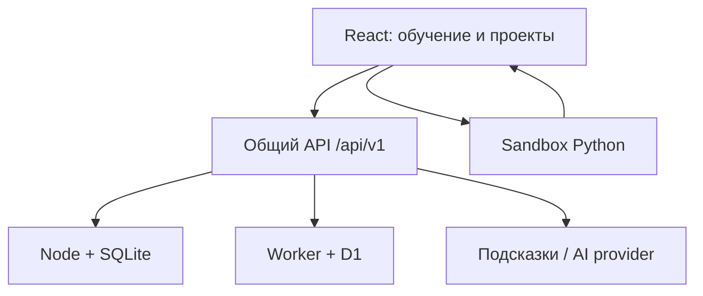

# Архитектура ПИТОН V5

## Два исполнения одного приложения

Клиент React/TypeScript и доменная логика одинаковы для двух поставок. Переносимая версия использует Vite, Node.js 24 и локальную SQLite. Размещённая версия использует Sites/Vinext, Cloudflare Worker и D1. SQL-операции скрыты за небольшим адаптером, а обработчик `handleApi(Request, options)` не зависит от HTTP-сервера.

`app/api/v1/[...path]/route.ts` получает проверенную платформой личность через server-only helper. `apps/api/server.ts` использует собственные сессии и пароли scrypt и не доверяет заголовкам личности, присланным браузером. Локальный сервер также обслуживает `dist/standalone`, поэтому production-интерфейс и API имеют общий origin.

## Контент как проверяемые данные

`packages/curriculum` содержит каталог из брифа, опубликованные уроки, миссии и граф навыков. Основной урок имеет стабильный `lessonId`, `contentVersion` и `assessmentVersion`. Каждый вариант содержит отдельные историю, задачу, теорию, стартовый код, редактируемый пример, решение, вопросы, четыре подсказки, перенос навыка, входные данные, описание сцены и проверки.

Три режима связаны общей целью и навыками. Их интерактивная часть самостоятельна: робот получает игровые команды; арена получает события появления объектов; отчёт получает возвращаемые данные и файлы. Миссии имеют собственные идентификаторы и тесты, а не подставляют идентификатор основного урока для получения XP.

Неготовые пункты имеют `available: false`. Зависимости открывают следующие опубликованные уроки; пилот `u5-l2` доступен для знакомства сразу. Порядок продвижения берётся из упорядоченного массива курса: локальный `order` внутри модуля не используется как сквозной индекс.

## Жизненный цикл запуска

Редактор фиксирует профиль, контент, режим, версию кода и версию проверок в контексте запроса. Изменение кода, профиля или варианта делает старый результат неприменимым. React-экраны и асинхронные операции проверяют актуальность контекста перед изменением состояния.

Runtime предварительно получает пять фиксированных файлов закреплённой версии Pyodide без cookies. Исполнение создаётся в iframe с непрозрачным origin и `sandbox="allow-scripts"`. После одноразового handshake используется приватный MessageChannel. Для каждого опубликованного кейса создаётся свежий Worker; глобальные переменные, модульное состояние и файловая система не переходят между кейсами.

Python harness собирает stdout/stderr, структурированную ошибку, трассу, возвращаемое значение, выходные UTF-8 файлы и разрешённые события. Сцена получает только события из whitelist. Пользовательский код не передаёт DOM, HTML, произвольные URL или произвольный JavaScript для исполнения интерфейсом.

Отмена и watchdog завершают worker. Ограничиваются длительность, объём вывода, число событий/строк трассы и файлы. Эта реализация не заявляет жёсткого потолка всей WASM-памяти или защищённого серверного оценивания. Полные контракты и ограничения: `RUNTIME.md`.

## Проверка и награда

Успешный preview только показывает поведение. Для завершения основного урока нужен полный успешный набор опубликованных тестов без ошибки/усечения результата и ответ рефлексии. API проверяет точное множество test ID, версии, текущий профиль, принадлежность урока и формат runtime evidence.

XP определяется серверным содержимым урока и выдаётся единожды по паре профиль/основной урок. Повторный режим либо повторный idempotency key не создают второй награды. Повторное использование run ID с новым запросом также отклоняется. Клиентское значение XP не принимается.

Освоение навыков хранится отдельно от XP: 0 — не начато, 1 — знакомство/попытка, 2 — с помощью, 3 — самостоятельно, 4 — устойчивое применение. Сервер учитывает подсказки и рефлексию; недавняя подсказка учитывается даже после обновления страницы. Повторение требует новой принятой попытки и наступившей даты задания. Серия практики и достижения выводятся из серверных записей.

## Черновики и проекты

Черновик идентифицируют профиль, контент и режим. Автосохранение выполняется последовательно с задержкой, использует CAS-ревизию и не затирает чужое изменение при конфликте 409. Экран предлагает восстановить серверную версию либо скачать свой текст. Код и XP не хранятся в localStorage; там остаётся только удобство выбора профиля.

Проект хранит код, входные файлы и конфигурацию сцены. Режим проекта фиксирован самим проектом. Изменение глобального режима профиля не переинтерпретирует его содержимое. Сохранение создаёт ревизию; остаются последние 10 версий. Восстановление тоже является новой записью с проверкой текущей ревизии. Экспорт — переносимый JSON с кодом и конфигурацией, а не скрытая ссылка на данные другого профиля.

## Интерфейс и доступность

Экраны лежат в `src/screens`, чтобы Sites не интерпретировал их как отдельный Pages Router. Главный компонент выбирает экран по URL и поддерживает history navigation. Проекты, помощник и прогресс имеют ключ профиля/режима для изоляции состояния.

Monaco подключается лениво только на широком экране с точным указателем для подростка и взрослого. Облегчённый textarea-редактор поддерживает отступы, номера строк, подсветку строки ошибки и выход клавишей Escape перед Tab. Настройки размера текста, контраста, звука и движения принадлежат профилю. CSS учитывает узкие экраны и системный reduced motion. Формальная браузерная приёмка и полная проверка вспомогательными технологиями остаются отдельным этапом.

## Данные и доверие

Схема Drizzle и две SQL-миграции лежат в `db/schema.ts` и `drizzle/`. Сущности охватывают пользователей и личности, сессии, профили, черновики, попытки, прогресс, навыки, проекты/ревизии, повторения, достижения, tutor и квоты запросов. Все операции пользовательских данных проверяют владельца на сервере.

Подсказки уровней 1–3 помогают без полного решения. Уровень 4 требует отдельного действия. Серверный provider опционален; его ошибка возвращает подготовленный материал. История хранит ответы помощника и факт передачи кода, но не отдельную копию пользовательского кода. Детали владения, CSRF, лимитов и резервных копий: `SECURITY.md`; машинное описание API: `API.openapi.json`.
